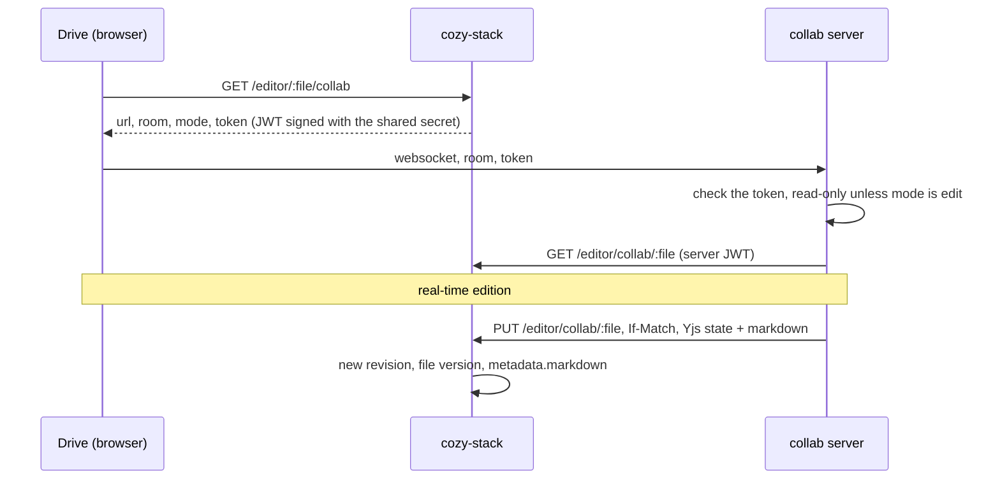

# POC: Docs notes in Twake Drive

A Docs note is a `.docsnote` file whose content is the Yjs state of a BlockNote document. Drive edits it in its own view (`src/modules/views/DocsNote`). A Hocuspocus server (`collab/`) runs the real-time collaboration. cozy-stack decides who joins a room and in which mode, and the server loads and saves the file through the stack.

This folder is a proof of concept. It needs the cozy-stack branch [`poc/docs-editor-collab`](https://github.com/Crash--/cozy-stack/tree/poc/docs-editor-collab), which adds the `/editor/:file-id/collab` routes.

## Flow



## Run it

1. Build cozy-stack from the branch above, statically, into `stack/bin/cozy-stack`:

   ```bash
   CGO_ENABLED=0 go build -o <this folder>/stack/bin/cozy-stack .
   ```

2. Build Drive at the repository root (`yarn build`), install the server (`cd collab && npm ci`).
3. `cp stack/.env.example stack/.env` and fill it.
4. `cd stack && docker compose up -d && ./setup.sh`.

The compose file publishes cozy-stack on `100.86.182.33:4600` and the collab server on `100.86.182.33:4603`, and resolves `*.100-86-182-33.nip.io` to the loopback inside the project. Change the address and the domain (in `docker-compose.yml`, `cozy.yml`, `setup.sh`) to run it elsewhere.

`setup.sh` creates an organization instance `acme` and two users, `alice` and `bob`, with two shared drives owned by `acme`: `Projet` (both can write) and `Annonces` (bob reads only).

Tests of the server: `cd collab && npm test`.
